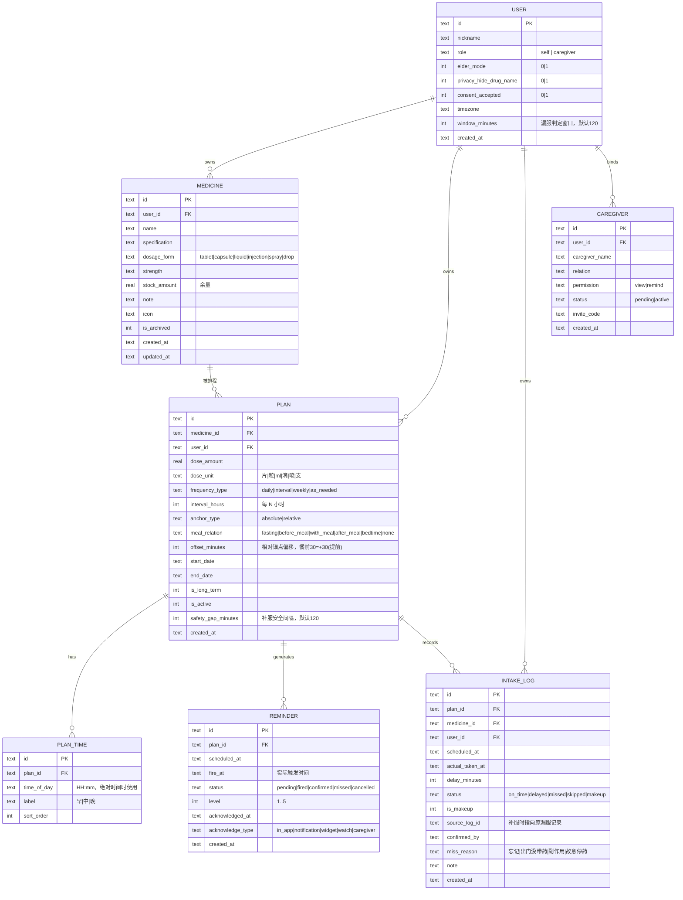

# 用药提醒 App · 数据模型与数据库设计

- 版本：v1.0
- 对应需求：《01-PRD-产品需求文档.md》
- 存储引擎：MVP 阶段为浏览器 localStorage（JSON 文档）；正式版为 SQLite（SQLCipher 加密），云同步为 PostgreSQL

---

## 1. ER 图



---

## 2. 建表 SQL（SQLite / 正式版）

```sql
PRAGMA foreign_keys = ON;
PRAGMA journal_mode = WAL;

-- ========== 用户 ==========
CREATE TABLE IF NOT EXISTS user (
  id                       TEXT PRIMARY KEY,
  nickname                 TEXT NOT NULL DEFAULT '我',
  role                     TEXT NOT NULL DEFAULT 'self',   -- self | caregiver
  elder_mode               INTEGER NOT NULL DEFAULT 0,
  privacy_hide_drug_name   INTEGER NOT NULL DEFAULT 0,
  consent_accepted         INTEGER NOT NULL DEFAULT 0,
  timezone                 TEXT NOT NULL DEFAULT 'Asia/Shanghai',
  window_minutes           INTEGER NOT NULL DEFAULT 120,   -- 漏服判定窗口
  notify_channels          TEXT NOT NULL DEFAULT '["notification","sound","vibrate"]',
  created_at               TEXT NOT NULL
);

-- ========== 药品 ==========
CREATE TABLE IF NOT EXISTS medicine (
  id             TEXT PRIMARY KEY,
  user_id        TEXT NOT NULL REFERENCES user(id) ON DELETE CASCADE,
  name           TEXT NOT NULL,
  specification  TEXT DEFAULT '',
  dosage_form    TEXT DEFAULT 'tablet',
  strength       TEXT DEFAULT '',
  stock_amount   REAL DEFAULT NULL,
  note           TEXT DEFAULT '',
  icon           TEXT DEFAULT 'pill',
  is_archived    INTEGER NOT NULL DEFAULT 0,
  created_at     TEXT NOT NULL,
  updated_at     TEXT NOT NULL
);
CREATE INDEX IF NOT EXISTS idx_medicine_user ON medicine(user_id, is_archived);

-- ========== 用药计划 ==========
CREATE TABLE IF NOT EXISTS plan (
  id                  TEXT PRIMARY KEY,
  medicine_id         TEXT NOT NULL REFERENCES medicine(id) ON DELETE CASCADE,
  user_id             TEXT NOT NULL REFERENCES user(id) ON DELETE CASCADE,
  dose_amount         REAL NOT NULL DEFAULT 1,
  dose_unit           TEXT NOT NULL DEFAULT '片',
  frequency_type      TEXT NOT NULL DEFAULT 'daily',   -- daily|interval|weekly|as_needed
  interval_hours      INTEGER DEFAULT NULL,
  anchor_type         TEXT NOT NULL DEFAULT 'absolute',-- absolute|relative
  meal_relation       TEXT NOT NULL DEFAULT 'none',
  offset_minutes      INTEGER NOT NULL DEFAULT 0,
  start_date          TEXT NOT NULL,
  end_date            TEXT DEFAULT NULL,
  is_long_term        INTEGER NOT NULL DEFAULT 1,
  is_active           INTEGER NOT NULL DEFAULT 1,
  safety_gap_minutes  INTEGER NOT NULL DEFAULT 120,
  created_at          TEXT NOT NULL
);
CREATE INDEX IF NOT EXISTS idx_plan_user     ON plan(user_id, is_active);
CREATE INDEX IF NOT EXISTS idx_plan_medicine ON plan(medicine_id);

-- ========== 计划时间点 ==========
CREATE TABLE IF NOT EXISTS plan_time (
  id          TEXT PRIMARY KEY,
  plan_id     TEXT NOT NULL REFERENCES plan(id) ON DELETE CASCADE,
  time_of_day TEXT NOT NULL,          -- 'HH:mm'
  label       TEXT DEFAULT '',
  sort_order  INTEGER NOT NULL DEFAULT 0
);
CREATE INDEX IF NOT EXISTS idx_plan_time_plan ON plan_time(plan_id, sort_order);

-- ========== 待触发提醒（本地调度表） ==========
CREATE TABLE IF NOT EXISTS reminder (
  id                TEXT PRIMARY KEY,
  plan_id           TEXT NOT NULL REFERENCES plan(id) ON DELETE CASCADE,
  scheduled_at      TEXT NOT NULL,
  fire_at           TEXT DEFAULT NULL,
  status            TEXT NOT NULL DEFAULT 'pending',
  level             INTEGER NOT NULL DEFAULT 1,
  acknowledged_at   TEXT DEFAULT NULL,
  acknowledge_type  TEXT DEFAULT NULL,
  created_at        TEXT NOT NULL
);
CREATE INDEX IF NOT EXISTS idx_reminder_pending ON reminder(status, scheduled_at);
CREATE UNIQUE INDEX IF NOT EXISTS uq_reminder_plan_time ON reminder(plan_id, scheduled_at);

-- ========== 服药记录（业务上不可篡改） ==========
CREATE TABLE IF NOT EXISTS intake_log (
  id              TEXT PRIMARY KEY,
  plan_id         TEXT NOT NULL REFERENCES plan(id) ON DELETE CASCADE,
  medicine_id     TEXT NOT NULL REFERENCES medicine(id) ON DELETE CASCADE,
  user_id         TEXT NOT NULL REFERENCES user(id) ON DELETE CASCADE,
  scheduled_at    TEXT NOT NULL,
  actual_taken_at TEXT DEFAULT NULL,
  delay_minutes   INTEGER DEFAULT NULL,
  status          TEXT NOT NULL,     -- on_time|delayed|missed|skipped|makeup
  is_makeup       INTEGER NOT NULL DEFAULT 0,
  source_log_id   TEXT DEFAULT NULL,
  confirmed_by    TEXT DEFAULT 'self',
  miss_reason     TEXT DEFAULT NULL,
  note            TEXT DEFAULT '',
  created_at      TEXT NOT NULL
);
CREATE INDEX IF NOT EXISTS idx_log_user_date ON intake_log(user_id, scheduled_at DESC);
CREATE INDEX IF NOT EXISTS idx_log_plan      ON intake_log(plan_id, scheduled_at);
CREATE UNIQUE INDEX IF NOT EXISTS uq_log_plan_sched ON intake_log(plan_id, scheduled_at, is_makeup);

-- ========== 家属绑定 ==========
CREATE TABLE IF NOT EXISTS caregiver (
  id             TEXT PRIMARY KEY,
  user_id        TEXT NOT NULL REFERENCES user(id) ON DELETE CASCADE,
  caregiver_name TEXT NOT NULL,
  relation       TEXT DEFAULT '',
  permission     TEXT NOT NULL DEFAULT 'view',   -- view|remind
  status         TEXT NOT NULL DEFAULT 'pending',
  invite_code    TEXT UNIQUE,
  created_at     TEXT NOT NULL
);
CREATE INDEX IF NOT EXISTS idx_caregiver_user ON caregiver(user_id, status);
```

> **关于 `caregiver.status` 的语义（P8-32 之后补充）**：
> 实际绑定发生在**另一台设备**上——家属凭邀请码向中继 `claim` 成功才算绑上，
> 而中继只回报**绑了几位**，不回报"是谁"。因此本机这张表**不能作为绑定的证据**：
> 默认 `status='pending'` 是刻意的（种子数据留空，`caregivers: []`）。
> 任何把本地行渲染成「已绑定」的做法都是在伪造事实——
> 真正的绑定数来自中继回报的 `user.relay.boundCount`，见 `08-家属协同服务端.md`。

---

## 3. 字段设计说明（关键决策）

| 决策 | 说明 |
|---|---|
| 时间统一存 `TEXT` ISO 8601 | SQLite 无原生日期类型；ISO 8601 可直接字符串比较排序，且带时区偏移便于跨时区处理 |
| `reminder` 与 `intake_log` 分离 | 提醒是**调度对象**，记录是**事实对象**。前者可取消重建，后者不可篡改（BR-02） |
| `intake_log` 用 `is_makeup` + `source_log_id` | 补服记录独立成行，通过 `source_log_id` 关联原漏服记录，实现"并存不覆盖"（BR-01/S5） |
| 唯一索引 `uq_reminder_plan_time` | 防止重复排程同一时间点，保证幂等重建 |
| 唯一索引 `uq_log_plan_sched` | 同一计划同一时间点只允许一条非补服记录，防止重复打卡 |
| `offset_minutes` 语义 | 表示"提前/延后量"。餐前 30 分钟存 30（提前），餐后 30 分钟存 -30（延后） |
| `is_active` 而非删除计划 | 停用保留历史，符合 BR-02 |
| `safety_gap_minutes` 存在 plan 级 | 不同药物的安全间隔可能不同，允许每计划独立配置 |

---

## 4. 排程算法

### 4.1 生成排程

```
FUNCTION generateSchedule(plan, fromDateTime, days = 90) -> Reminder[]
  result = []
  cursor = startOfDay(fromDateTime)

  FOR d = 0 TO days - 1:
    day = cursor + d days
    IF NOT plan.coversDay(day): CONTINUE

    times = resolveTimesForDay(plan, day)
    FOR each t IN times:
      scheduledAt = combine(day, t) + plan.deltaMinutes()
      // deltaMinutes: 餐前 = -offset, 餐后 = +offset, 其他 = 0
      IF scheduledAt <= now AND isArchived(scheduledAt): CONTINUE   // 不回填历史
      IF scheduledAt already exists in reminder: CONTINUE           // 幂等
      result.push(Reminder{plan_id, scheduled_at: scheduledAt, status:'pending'})

  RETURN result

FUNCTION resolveTimesForDay(plan, day):
  IF plan.anchor_type == 'absolute':
    RETURN plan.planTimes            // 直接用 HH:mm
  ELSE:
    anchor = getRelativeAnchor(plan, day)   // 如"本次进餐时间"，无则回退默认
    RETURN [anchor + plan.offsetMinutes]
```

### 4.2 状态判定

```
FUNCTION classify(actualAt, scheduledAt, windowMinutes):
  delay = minutesBetween(scheduledAt, actualAt)
  IF delay <= 30:            RETURN 'on_time'
  IF delay <= windowMinutes: RETURN 'delayed'
                             RETURN 'missed'
```

### 4.3 提醒升级

```
FUNCTION onReminderDue(reminder):
  reminder.fireAt = now
  reminder.level = 1
  notify(level=1, channel='notification+sound+vibrate')

  scheduleCheck(at = fireAt + 5min,  action = escalate(level=2))
  scheduleCheck(at = fireAt + 15min, action = escalate(level=3, fullscreen=true))
  scheduleCheck(at = fireAt + 30min, action = escalate(level=4, notifyCaregiver=true))
  scheduleCheck(at = fireAt + window, action = markMissed)

FUNCTION escalate(n):
  IF reminder.status == 'confirmed': RETURN   // 已确认则中断升级链
  reminder.level = n
  applyChannel(n)

FUNCTION onConfirm(reminder, at, type):
  IF reminder.status IN ('confirmed','cancelled'): RETURN   // 幂等
  log = IntakeLog{ scheduled_at: reminder.scheduledAt,
                   actual_taken_at: at,
                   delay_minutes: minutesBetween(reminder.scheduledAt, at),
                   status: classify(at, reminder.scheduledAt, plan.window),
                   confirmed_by: type }
  INSERT log
  reminder.status = 'confirmed'; reminder.acknowledged_at = at
  cancelPendingSiblings(plan.id, reminder.scheduledAt)   // 只取消本次，不动其他时间点

FUNCTION markMissed(reminder):
  IF reminder.status == 'confirmed': RETURN
  log = IntakeLog{ status:'missed', actual_taken_at: NULL }
  INSERT log (upsert by uq_log_plan_sched)
  reminder.status = 'missed'
  openMakeupFlow(reminder)

FUNCTION openMakeupFlow(reminder):
  nextAt = getNextScheduledAt(reminder.plan_id, now)
  gap    = minutesBetween(now, nextAt)
  IF gap > plan.safety_gap_minutes:
     ask("是否现在补服？", options=[补服, 跳过])
  ELSE:
     ask("已接近下次服药时间，建议跳过本次，请遵医嘱", options=[知道了])
  // 任何分支都不给出剂量建议（BR-04）
```

### 4.4 重启恢复

```
FUNCTION onAppStart():
  pending = SELECT * FROM reminder WHERE status='pending' AND scheduled_at > now
  IF pending.length == 0 AND hasActivePlans():
     regenerateAll()          // 本地库丢失或首次运行
  rescheduleAll(pending)       // 重建系统级本地调度
  checkOverdue()               // 补偿启动前已错过但未标记的提醒 → markMissed
```

---

## 5. 轻量版存储结构（MVP 实现用）

MVP 使用 localStorage 单 key 存储，结构与上表一一对应，便于后续迁移 SQLite：

```json
{
  "version": 1,
  "user": {
    "id": "u_xxx", "nickname": "我", "elderMode": false,
    "hideDrugName": false, "consentAccepted": true,
    "timezone": "Asia/Shanghai", "windowMinutes": 120,
    "channels": ["notification", "sound", "vibrate"]
  },
  "medicines": [
    { "id": "m_xxx", "name": "苯磺酸氨氯地平片", "specification": "5mg",
      "dosageForm": "tablet", "strength": "5mg", "note": "血压高时服用",
      "isArchived": false, "createdAt": "...", "updatedAt": "..." }
  ],
  "plans": [
    { "id": "p_xxx", "medicineId": "m_xxx", "doseAmount": 1, "doseUnit": "片",
      "frequencyType": "daily", "anchorType": "absolute",
      "mealRelation": "before_meal", "offsetMinutes": 30,
      "times": ["07:00", "12:00", "18:00"],
      "startDate": "2026-10-10", "endDate": null, "isLongTerm": true,
      "isActive": true, "safetyGapMinutes": 120, "createdAt": "..." }
  ],
  "reminders": [
    { "id": "r_xxx", "planId": "p_xxx", "scheduledAt": "2026-10-11T07:00:00+08:00",
      "status": "pending", "level": 0, "fireAt": null,
      "acknowledgedAt": null, "acknowledgeType": null }
  ],
  "logs": [
    { "id": "l_xxx", "planId": "p_xxx", "medicineId": "m_xxx",
      "scheduledAt": "...", "actualTakenAt": "...", "delayMinutes": 4,
      "status": "on_time", "isMakeup": false, "sourceLogId": null,
      "confirmedBy": "self", "missReason": null, "note": "", "createdAt": "..." }
  ],
  "caregivers": []
}
```

**迁移路径**：字段命名保持一致（逻辑字段名 camelCase ↔ SQL snake_case 一一映射），云同步时用一个 `toSqlRow()` 适配层即可，无需重写业务代码。

---

## 6. 数据安全

| 项 | MVP | 正式版 |
|---|---|---|
| 本地存储 | localStorage（明文，仅供演示） | SQLite + SQLCipher 加密，密钥存 Keychain/Keystore |
| 传输 | 无网络传输 | 全程 TLS 1.3 |
| 导出 | JSON 明文导出 | 密码加密的备份文件 |
| 删除 | 设置页"一键删除全部数据" | 同上 + 云端软删除 + 30 天后物理清除 |
