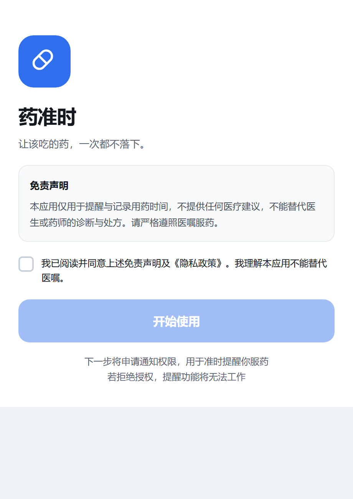
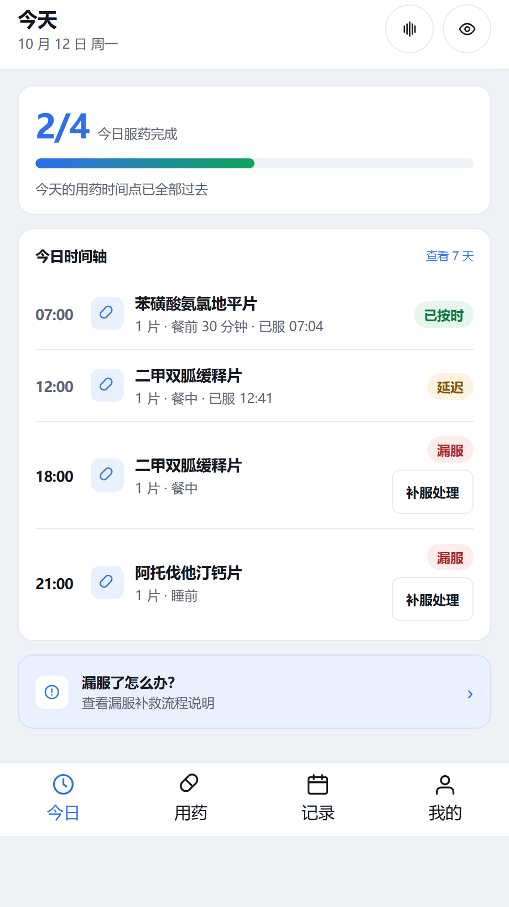
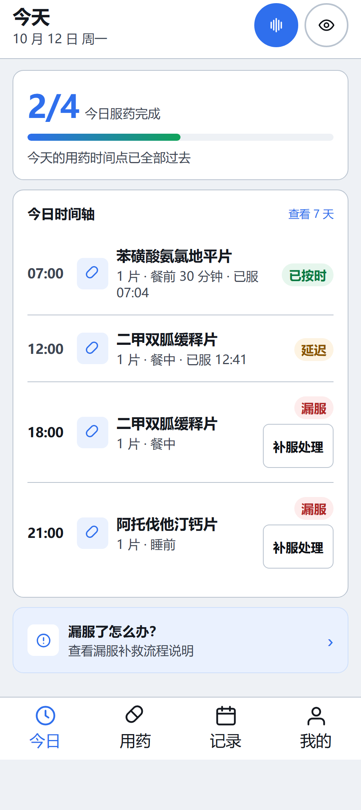
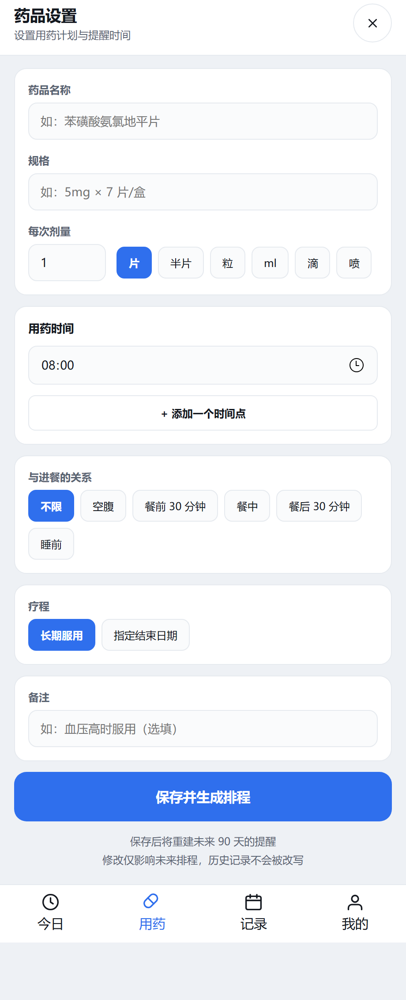
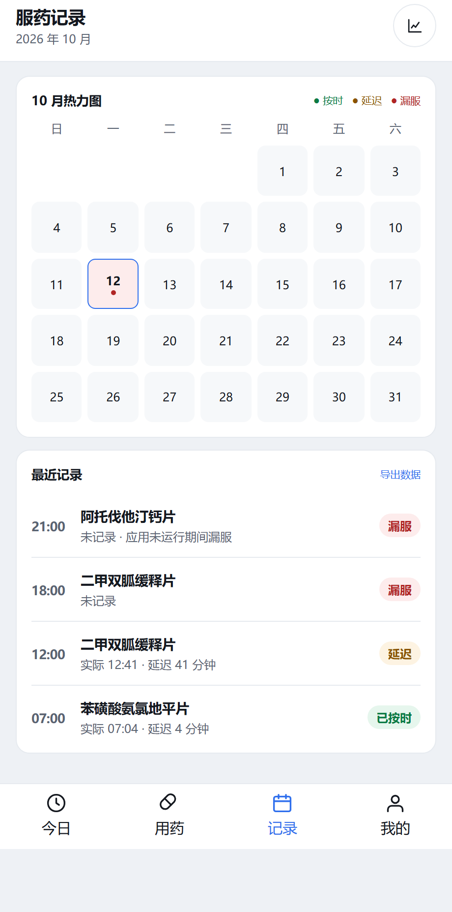
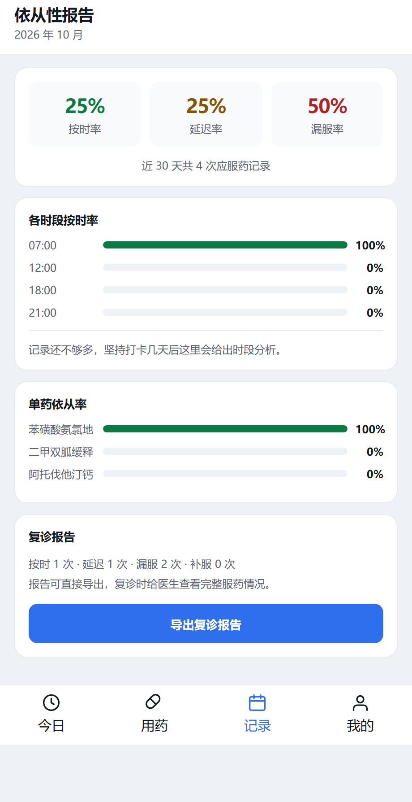
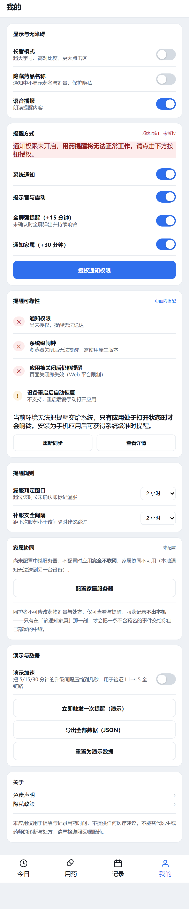
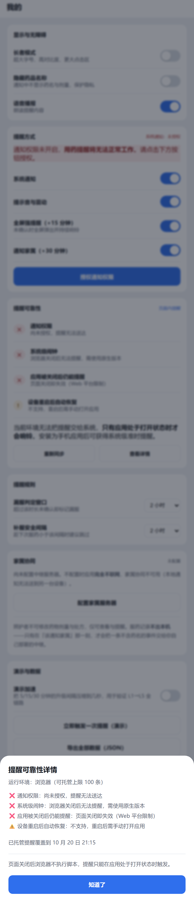
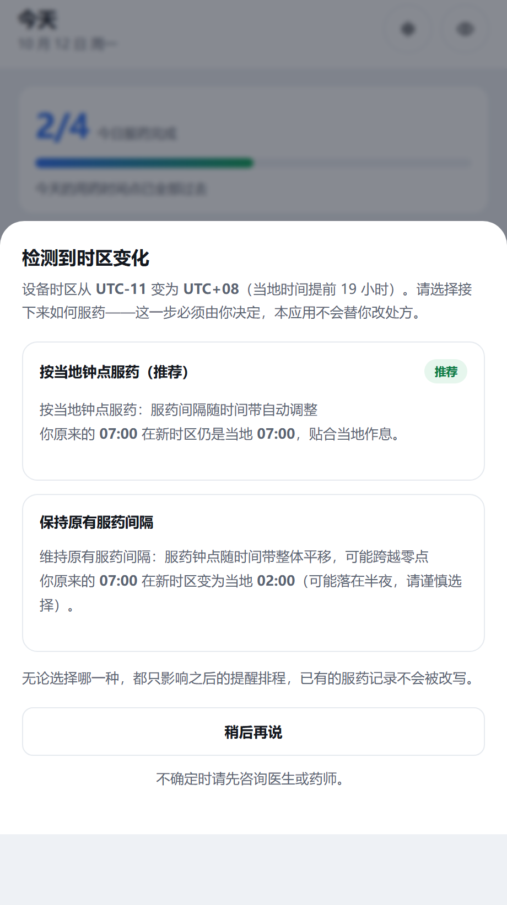
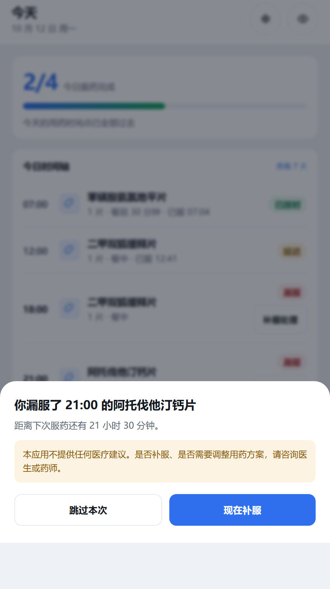

# 07 · 关键页面 UI 稿

> 图由 `app/tools/ui-shots.mjs` 从**真实运行的应用**中截取，不是手工绘制的设计稿——
> 所以文档里的图与当前代码永远一致，不存在"图是三个月前的版本"这种漂移。

| 项 | 说明 |
|---|---|
| 生成方式 | Chrome DevTools Protocol 驱动 Edge/Chrome 无头模式，打开真实页面并整屏截图 |
| 截图尺寸 | 逻辑宽度 460 CSS px，设备像素比 2，故文件为 **920 px 宽**；高度按内容自适应（09/10 因弹层与全屏层被机型撑高到 4278 px） |
| **清单字段口径** | `width`/`height` = **文件本身的像素尺寸**；`cssWidth`/`cssHeight` = 逻辑尺寸；`viewportHeight` = 截图时视口设置。三者分列，互不冒充——旧版把第三个当成第一个写进清单，于是清单说 `09` 是 `460×1040`、文件其实是 `920×4278`（见 `03-测试用例清单.md` P8-33） |
| **确定性时钟** | 截图时页面内的「现在」被固定为**当天 23:30**，使 UI 稿与运行时刻无关 |
| 生成命令 | `cd app && node tools/ui-shots.mjs --port 8788`（需先起静态服务器） |
| 产物 | `docs/ui/*.png` 12 张 + `docs/ui/manifest.json`（含 sha256，可核对图有没有被换过） |
| 附带断言 | 43 项（每个页面「真的渲染出来了」才算数，且清单必须与磁盘文件逐张对得上）。任一页渲染异常即非 0 退出 |
| **清单自校验** | 写完清单后**反过来读一遍磁盘上的 PNG**，逐张比对尺寸与 sha256；并校验「逻辑尺寸 × 设备像素比 = 记录的真实像素尺寸」 |
| 可复现性 | **已实测：连续两次生成，12 张图逐字节一致**（sha256 全等） |
| 视口基准 | 375 × 780 的模拟机身（`.phone`），与原型一致 |

**为什么让截图脚本同时做断言**：如果只截图不断言，一个白屏页面也会被安静地存成一张
PNG，然后贴进文档看起来"有图有真相"。加上断言，「这个页面渲染出来了」和「这张图被生成」
就是同一件事的两个侧面。

---

## 〇、为什么需要「确定性时钟」（这一段比图本身更重要）

应用自带的演示种子只为**「今天已经过去的时间点」**补服药历史，
而记录页与统计页又都会按 `now` 过滤掉未来的时间点。
于是如果在凌晨 00:0x 生成 UI 稿，一剂都还没到点——
记录页与统计页全空、今日页四剂全是待服，交付物既没有信息量，也**不可复现**
（同一份代码在不同时刻生成出完全不同的图）。

**走过一条错路，值得记下来**：第一版做法是直接用应用自身的公开接口
（`Store.ensureReminder` / `confirmReminder` / `markMissed`）把今日「补」出结果。
结果得到一个**自相矛盾的状态**——07:00 的服药记录落在未来，
被按 `now` 过滤的统计正确排除了，截图上赫然写着「近 30 天共 0 次应服药记录」。

> 这说明一件事：**伪造与真实时钟相冲突的状态，不会得到"看起来对"的画面，
> 只会得到一个更隐蔽的错误画面。**
> 数据可以造假，但拿它去对撞真实时钟时，一定会露馅——
> 而且露馅的方式往往是"看起来正常但数字是 0"，比直接报错更难发现。

**正确做法是让时钟走到那个时刻，而不是让数据假装时钟已经走到了。**
生成器通过 CDP 的 `Page.addScriptToEvaluateOnNewDocument` 在**每个文档的最前面**
替换 `Date`（含 `Date.now()`、`new Date(...)` 与 `Date()` 调用），
应用代码一行不改，行为与真实运行完全一致。

选 **23:30** 而非任意时刻：此时当天 4 个服药点（07:00 / 12:00 / 18:00 / 21:00）
全部已过，且 21:00 已超出 120 分钟服药窗口——今日页因此呈现
「2 剂有结果 + 2 剂漏服」这一**信息量最大**的状态，记录页与统计页也都有数据可看。

### 截图模式：另外三处非确定性来源

要真正做到逐字节复现，光固定时钟还不够。生成器在截图前还会做三件事：

| 调整 | 不调整会怎样 |
|---|---|
| 冻结所有 `animation` / `transition` | L3 全屏强提醒的铃铛有脉冲动画、弹层有 slideup，每次抓到的帧都不同 |
| `.sheet` 的 `max-height:80%` → `none` | 它与"机身高度自适应"形成**循环依赖**（弹层高度取决于机身高度，机身高度又取决于弹层高度），结果依赖上一次视口，弹层截图高度会漂移 |
| 清掉尚未消失的 toast | toast 有 2.6 秒渐隐窗，抓到的可能是半透明中间态 |

这三项都写在 `app/tools/ui-shots.mjs` 的 `capture()` 里，注释说明了原因。
除 `max-height` 外都不改变视觉呈现（该页弹层内容本来就没到 80%）。

> **可复现性已验证**：修正上述问题后连续生成两次，12 张图的 sha256 **全部相同**。
> 在此之前是 9/12——差异全部出现在带弹层或带动画的那几张，
> 这也正是"为什么必须验证可复现，而不是声称可复现"的直接证据。

---

## 一、首启引导与免责声明

首次启动必须勾选同意才能进入，按钮在未勾选时置灰且 `pointer-events:none`。
文案明确划出边界：**不提供任何医疗建议、不能替代医生或药师的诊断与处方**。
下方提前告知下一步会申请通知权限，以及拒绝授权会带来什么后果——
不让用户在不知情的情况下被弹窗。

---

## 二、今日页 · 用药时间轴

全应用的主界面。顶部摘要先回答唯一重要的问题：**下一剂几点吃**（或当天已全部服完）。
下方按时间列出全天安排，每条给三个信息：时间、药名 + 剂量 + 餐前餐后、当前状态。

四种状态都有独立徽标，**并且用颜色 + 文字双重表达**，不依赖颜色单独承载信息
（色觉障碍用户同样可读）：

| 状态 | 徽标 | 说明 |
|---|---|---|
| 已按时 / 延迟 / 补服 | 绿色 / 橙色徽标 | 已确认，行整体淡化，退到视觉后层 |
| **漏服** | **红色徽标 + 「补服处理」按钮** | 超出服药窗口后自动标记 |
| 已跳过 | 灰色徽标 | 用户主动跳过，原漏服记录保留 |
| 时间已过但未记录 | 「补录」按钮 | 还在窗口内，允许补录，避免静默丢失 |

> **漏服徽标是补上的。** 生成这版 UI 稿时从截图里发现：原本「已按时 / 延迟 / 已跳过」
> 都有徽标，**唯独漏服只有一个「补服处理」按钮、没有任何状态文字**——
> 而记录页对同一状态用的是「漏服」徽标，两处不一致。
> 对一款用药提醒产品，漏服恰恰是最需要被看见的那个状态。
> 已在 `app/js/app.js` 的 `renderToday()` 补齐，并在 `browser-check.mjs` 第 10 组
> 加了 3 项断言锁住，避免被改回去。详见 `docs/04` §4.6。

---

## 三、今日页 · 长者模式

面向 55+ 用户的核心适配。开启后：

- 根字号 **15px → 20px**（约 1.33×），点击区不小于 44px（长者模式下按钮 ≥ 56px）
- 次要文字加深（对白底 9.5:1）、描边加重，分区更清楚
- 药名与剂量信息**允许换行完整显示**——字大了以后单行省略会把「已服 07:04」截掉，
  对需要看清用药细节的人正好是倒退
- 关闭动画与背景模糊，减少视觉干扰

**打卡路径只有两步**：打开应用 → 点「我已服药」。满足 DoD 第 7 条「3 步内完成打卡」。

> 如实说明：长者模式只调整了字号、对比度、点击区与动效。
> 它**没有**重排信息层级或减少卡片数量（早期文档曾写成"简化层级"，属表述不准，
> 已在 `docs/04` §4.4 记为缺陷并改正）。真正的可用性结论需要真实老年用户测试才能给出。

---

## 四、用药与处方列表

一张药品卡承载多条用药计划，副标题直接写出「一天几点吃、餐前还是餐中」。
余量不足时用橙色徽标提示。

列表项是**真 `<button>`** 而不是带 `onclick` 的 `div`——键盘 Tab/Enter 和读屏器
天然可用，不需要自己补 `tabindex` + `keydown`（补漏一处就成了「只有鼠标能用」）。

---

## 五、药品编辑页 · 新增处方

一张长表单覆盖完整处方信息：药名、规格、每次剂量与单位、用药时间（可加多个时间点）、
与进餐的关系（不限 / 空腹 / 餐前 30 分钟 / 餐中 / 餐后 30 分钟 / 睡前）、疗程、备注。

底部固定说明了两件容易被误解的事：

- 「保存后将重建未来 90 天的提醒」
- 「修改仅影响未来排程，**历史记录不会被改写**」（DoD 第 6 条）

「餐前 30 分钟」这类相对锚点由排程引擎换算成绝对时间，跨时区时按锚点整体平移，
而不是按钟点平移——这是 `docs/04` §4.2 里的一处修复。

---

## 六、记录页 · 日历热力图

按日汇总按时 / 延迟 / 漏服三种状态，点任一天展开当天逐条明细。
下方列出最近记录，漏服条目会写出未记录的原因。

改动处方**不会改写历史**：历史记录只有读路径，这是设计约束（BR-01），
由 `smoke.test.cjs` 的排程幂等与历史不变断言锁住。

---

## 七、依从性统计 · 复诊用

按药品聚合按时率，用横向条对比。补服**单独计数但不覆盖原漏服记录**——
复诊时给医生看的应当是完整事实，而不是被美化过的数字。

---

## 八、设置页 · 提醒可靠性与隐私

设置页承载全项目最重要的一块**诚实界面**：提醒可靠性卡片。

它如实报告本平台的托管能力——能托管多少条、权限是否已授予、
**应用关闭后提醒会不会响**——而不是含糊地展示一个看起来很可靠的开关。
在 Web 平台上会明确写出「应用关闭后提醒无法工作」，并指向原生版本。

详见下方第九节的详情弹层。隐私模式（隐藏药名）、长者模式、免责声明、
隐私政策都从这一页可达。

**家属协同卡片（P8 改版后）**是这一页第二块"诚实界面"。
它不再显示一个写死的邀请码，而是分两种状态如实呈现：

| 状态 | 卡片显示 | 原因 |
|---|---|---|
| 未配置 | 「未配置」+ 说明"不配置时应用完全不联网，家属协同不可用" | 默认不联网是给用户的承诺，界面上必须说清楚 |
| 已配置 | 「已连接」+ 服务器地址 + 邀请码 + **中继侧已绑定家属 N 位** + **上次投递结果** | 两个数字都来自服务端回报，本地编不出来 |

「上次投递」一行有三种写法，互不混淆：
**已送达 N 位家属** / **未送达任何家属** / **上次投递失败：<原因>**。
这一点是刻意设计的——旧版本这里什么都不显示，只在漏服那一刻弹一句
「已通知 N 位家属」，而实际上一个请求都没发出去。

> **这一页在 P8-32 又改过一次，理由值得记。** 改版后这张卡片上曾经同时出现
> 「未配置」「不配置时完全不联网」和一排绿色的「女儿 · 小张 / 已绑定」——
> 那排「已绑定」来自 `Store.state.caregivers`，一份**本机列表**，
> 而绑定其实发生在另一台设备上，本机根本不知道有谁绑了。
> 种子里那条写死的演示家属于是变成了一枚冒充绑定的徽标。
>
> 现在这一页**不再渲染任何本地"家属"行**：绑定数只由中继回报。
> 这也解释了 `08-me.png` 为什么比其他图矮了 60 px——少的正是那行假记录。

---

## 九、提醒可靠性详情

四行逐条自检，每行一个明确的 ✓ / ✗ 与原因：

| 检查项 | Web 平台上的实际结论 |
|---|---|
| 通知权限 | 未授权：无法发送系统通知 |
| 系统闹钟 | 浏览器无系统闹钟可用，需用原生版本 |
| 应用关闭后 | 提醒不会触发（Web 平台限制） |
| 设备重启后 | 不支持，需重新打开应用 |

底部如实写明「本平台无法调度系统级提醒，只能靠应用打开时自查」，
并给出两条可执行的出路：用原生版本，或保持应用在前台。

> 这一页的存在本身就是一个设计立场：对用药提醒产品，
> **让用户对风险有准确预期，比让界面显得完美更重要。**

---

## 十、L3 全屏强提醒

升级链的第三级：L1 通知 → 5 分钟 L2 加大音量震动 → **15 分钟 L3 全屏强提醒**
→ 30 分钟 L4 通知家属 → 超窗标记漏服。

全屏红色覆盖，两个大按钮（我已服药 / 稍后提醒 10 分钟），视线无处可逃。
同时带 `role="alertdialog"` + `aria-modal="true"`，读屏器会**立即播报**
而不是静默弹出一个 div。

> 位置是"算"出来的而不是"累加"出来的：等级由当前时间反推。
> 因此刷新页面、重新打开、或应用被挂起后恢复，都会落在正确的阶段，不会漏级也不会重放。
> 这也是自适应轮询（`docs/04` §4.5）能够安全成立的前提。

---

## 十一、跨时区 · 二选一

检测到时区变化后**不擅自决定**，把选择权交给用户，并把两个选项的后果都换算成具体钟点：

- **按当地钟点服药（推荐）**：原来的 07:00 在新时区仍是当地 07:00
- **保持原有服药间隔**：原来的 07:00 在新时区变为当地 02:00（并提示可能落在半夜）

底部明确「无论选择哪一种，都只影响之后的提醒排程，已有的服药记录不会被改写」，
以及「不确定时请先咨询医生或药师」。

---

## 十二、漏服补救询问

超出服药窗口后弹出，如实告知漏服的是哪一剂，并把**距下次服药的间隔**算出来告知用户
（判断依据是距下次服药的时间，而不是简单的"过了多久"）。

给两个可执行的选择：跳过本次 / 现在补服。**补服记录独立留存，不覆盖原漏服记录。**

底部固定提示：「本应用不提供任何医疗建议。是否补服、是否需要调整用药方案，
请咨询医生或药师。」——全程不给任何剂量建议（DoD 第 5 条）。

---

## 十三、这 12 张图覆盖了什么、没覆盖什么

**覆盖**：主干流程的每一个界面状态——引导、日常查看、无障碍模式、药箱管理、
处方录入、历史记录、统计、设置与自检、强提醒、跨时区、漏服补救。

**没覆盖**（需要真机才能拍）：

| 缺口 | 为什么 |
|---|---|
| 系统通知栏 / 锁屏通知 | 需要真实设备的通知系统 |
| 原生全屏闹钟（后台唤起） | 需要 Android 前台服务，当前仅前台生效 |
| 平板 / 深色模式 / 横屏 | 未实现，非本期范围 |
| 读屏软件实际操作过程 | 是动态过程，截图表达不了；见 `docs/03` §四 人工核对清单 A-01~A-06 |
| 真实老年用户的使用表现 | 需要真人测试，本轮未执行 |

**边界**：这些图证明的是"界面渲染正确、布局无遮挡、状态可辨认"。
它们**不能**证明可用性好、不能替代无障碍合规认证、也不能替代真机验收。

还有一条必须说明白：**图里的时间是设定的演示时刻（当天 23:30），不是生成时的真实钟点。**
这是刻意的——它让同一份代码在任何时候生成的 UI 稿都完全一致。
代价是：**不能拿这些图去核对"当前时刻的状态是否正确"**，
那件事由 `browser-check.mjs` 在真实时钟下断言（第 10 组就在做这件事）。
两类验证各管一头，不能互相替代。
